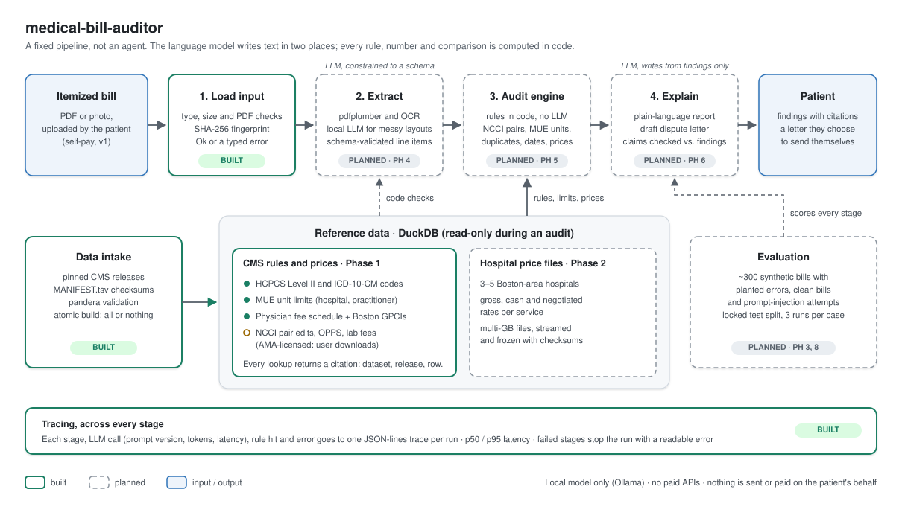

# medical-bill-auditor

## The problem

Hospital bills are long lists of codes and prices that most patients can't check. Common errors include duplicate charges, one procedure split into several billed parts, impossible quantities, and prices that don't match the hospital's own price list.

The rules to catch these are public: Medicare publishes which codes can't be billed together and how many units are allowed per day, and hospitals must publish their prices. But this information is buried in large technical files that patients never see.

## What it does

You upload an itemized bill. The tool checks each line against those public rules and prices, then gives you:

- a plain-language report of what looks wrong, with the source of each finding
- a draft letter you can use to question the charges

It is a tool for asking better questions, not legal or medical advice.

## How it works



1. **Read the bill:** turn a PDF or photo into structured line items.
2. **Check it:** apply Medicare's rules and compare prices, all in code.
3. **Explain it:** a local language model writes the report and letter from the findings only.

All of this runs on your machine with a free local model. Nothing is sent anywhere.

## Status

| Part | Status |
|---|---|
| Project foundations and tracing | Done |
| Medicare reference data | Mostly done |
| Hospital price data | Planned |
| Test bills for evaluation | Planned |
| Reading bills | Planned |
| Error checks | Planned |
| Report and letter | Planned |
| Web app | Planned |

## Getting started

```bash
git clone https://github.com/sanskrutimahajan/medical-bill-auditor.git
cd medical-bill-auditor
uv sync
make check
```

See the [build plan](docs/PLAN.md) for the full roadmap.
